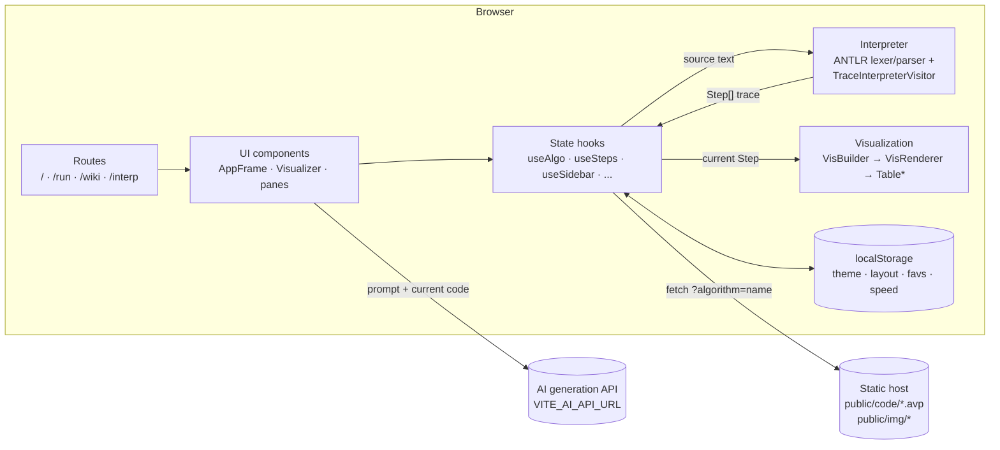
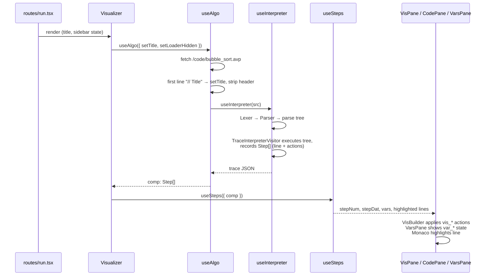
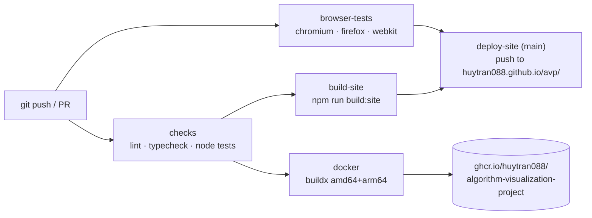

# Architecture

The Algorithm Visualization Project (AVP) is a **fully client-side** single-page
application. It is built with React Router v7 in framework mode with SSR
disabled, and every route is prerendered to static HTML at build time. No
backend is required; the only network calls are for static `.avp` files
and the optional AI generation endpoint.

## High-level overview



## Request → visualization pipeline

This is what happens when a user opens `/run?algorithm=bubble_sort`:



Editing code in the Code pane goes through `useEditSrc`. **Save** writes back
to `src`, which re-runs the interpreter and produces a new trace. **Discard**
restores the last saved source.

## Directory layout

```
app/
├── root.tsx                # HTML shell, error boundary, global CSS
├── routes.ts               # Route table (index, run, interp, wiki)
├── routes/                 # Page components
│   ├── index.tsx           #   Home: searchable grid of algorithm cards
│   ├── run.tsx             #   Visualizer page
│   ├── wiki.tsx            #   User guide (placeholder)
│   └── interp.tsx          #   Developer page: shows JS / parse tree / trace
├── globals.ts              # App constants, menu links, algorithm catalogue,
│                           #   base path, AI endpoint
├── defs.ts                 # Monaco language + light/dark themes for .avp
├── types.ts                # Step / VisData shared types
├── contexts/               # DarkModeContext, ModifiedContext
├── hooks/
│   ├── useAlgo.ts          # Load .avp file → source → compiled steps
│   ├── useInterpreter.ts   # Run ANTLR + visitors on source
│   ├── useSteps.ts         # Step cursor, variable history, prev/next
│   ├── useEditSrc.ts       # Edit buffer with save/discard
│   ├── useStepTimer.ts     # Autoplay timing
│   ├── useVisAdjust.ts     # Speed + zoom (persisted)
│   ├── useVisPan.ts        # Drag-to-pan the canvas
│   ├── useVisProgressInter.ts # Progress-bar scrubbing
│   ├── useSidebar*.ts      # Sidebar & pane sizes (persisted)
│   ├── useSearch.ts        # Home page search/sort/tags/favourites
│   ├── useDarkMode.ts, useTitle.ts, useModified.ts, usePortrait.ts, ...
│   └── interpreter/
│       ├── Pseudocode.g4             # ANTLR grammar (source of truth)
│       ├── .antlr/                   # GENERATED by `npm run build-g4` (git-ignored)
│       ├── TraceInterpreterVisitor.ts# Executes code, emits Step[] trace
│       ├── TsInterpreterVisitor.ts   # Transpiles to JavaScript (debug view)
│       └── TraceType.ts              # Trace action types
├── components/
│   ├── frames/             # AppFrame (top bar, menu, theme), VisualizerLayout
│   ├── headers/            # TopBar, PaneHeader
│   ├── panes/              # VisPane, CodePane, VarsPane, AIPane
│   ├── visualization/      # VisFrame (controls), VisBuilder (state machine),
│   │   └── table/          #   VisRenderer, Table* primitives (marks, text)
│   ├── Monaco.tsx          # Code editor with line highlighting
│   ├── SearchProvider.tsx, SearchCard.tsx, MainMenu.tsx, Loader.tsx, ...
└── resources/img/          # Test/placeholder assets imported by modules

public/
├── code/*.avp              # Bundled algorithms (first line: "// Title")
├── img/*_{light,dark}.png  # Card thumbnails per theme
└── manifest.json, favicon.ico

tests/                      # Mirrors app/; *.node.test.ts run in Node,
                            # *.render.test.tsx run in real browsers (Playwright)
docs/                       # This documentation
scripts/stage-site.mjs      # Merges the build into a servable build/site/
Dockerfile, docker/         # nginx image + config template
.github/workflows/ci-cd.yml # CI (tests) + CD (Pages, GHCR)
```

## Key concepts

### The trace (`Step[]`)

The interpreter does not animate anything itself. It **executes the program
once** and records a flat list of steps:

```ts
type Step = {
  line: number | [number, number];       // source line(s) to highlight
  actions: { cmd: string; params: {...} }[];
};
```

There are two families of action commands:

| Family | Commands | Consumed by |
| --- | --- | --- |
| Variables | `var_add`, `var_delete`, `var_highlight`, `var_greyout`, `var_normal` | `useSteps` → `VarsPane` |
| Visualization | `vis_init`, `vis_mark`, `vis_unmark`, `vis_log`, `vis_insert`, `vis_delete`, `vis_update`, `vis_swap`, `vis_sort` | `VisBuilder` → `VisRenderer` |

Because the trace is precomputed, stepping backward is cheap. `useSteps` keeps
a history of variable snapshots, and `VisBuilder` keeps previous frames.

Loops are capped at 1000 iterations so that a user's infinite loop cannot
freeze the tab.

### Visual directives

Authors control the visualization with `@directive<...>` annotations placed
before a statement or parameter (e.g. `@init<table> arr`,
`@mark<i, highlight, green>`). The trace visitor also adds marks automatically
for comparisons and array accesses. See [PSEUDOCODE.md](./PSEUDOCODE.md).

### Persistence

UI preferences are stored in `localStorage`:

- `theme`
- `sidebar`, `sidebarWidth`
- `codePaneHeight`, `varsPaneHeight`, `AIPaneHeight`
- `speed`, `zoom`
- `title`
- `favs`, `activeTags`, `search`, `sort`

Nothing is sent to a server except AI prompts.

### AI pane

`AIPane` builds a prompt containing the language rules and the current code,
then POSTs `{ message }` to `Globals.AIApiURL` (overridable with
`VITE_AI_API_URL`). It expects `{ generated_code }` back. The returned code is
loaded into the editor in editing mode, so the user must explicitly **Save**
it.

### Base path

The app is served under `Globals.RouteBaseName`. It is resolved from the
`VITE_BASE_PATH` env variable at build time and defaults to
`/avp/` (GitHub Pages, https://huytran088.github.io/avp/). Vite `base`, React Router
`basename`, prerendered paths and every asset/link URL derive from it.

### Deployment



`scripts/stage-site.mjs` turns the React Router output into one servable tree
(`build/site/`). The Docker image builds that tree in a Node stage and copies it
into `nginx:alpine`, under the configured base path. The nginx config
(`docker/nginx.conf.template`) resolves prerendered routes (`/run/` →
`run/index.html`) and falls back to the SPA shell for unknown paths.

## Build & test toolchain

| Concern | Tool |
| --- | --- |
| Dev server / bundler | Vite 8 + `@react-router/dev` |
| Styling | Tailwind CSS v4 + Material Tailwind v3 |
| Parser generation | `antlr-ng` → TypeScript, runtime `antlr4ng` |
| Unit tests (logic) | Vitest, `*.node.test.ts` |
| Component tests | Vitest browser mode + Playwright (Chromium, Firefox, WebKit), `*.render.test.tsx` |
| Lint / types | ESLint 10 (+ `@stylistic`) / `tsc` via `react-router typegen` |

## Known gaps / roadmap

- The **Open**, **Import**, **Export** and **About** menu items are stubs
  (`alert('TODO')`, disabled) in `app/globals.ts`.
- `/wiki` is a placeholder page.
- `/interp` is a developer debugging page and is marked for removal before
  production.
- `vis_sort` handling in `VisBuilder` is unverified, and `VisBuilder` still
  renders a raw JSON dump of its state for debugging.
- The language has no `do ... while` documentation beyond the grammar, and no
  compound `*=`, `/=` or `%=` assignment (only `=`, `+=` and `-=`).
